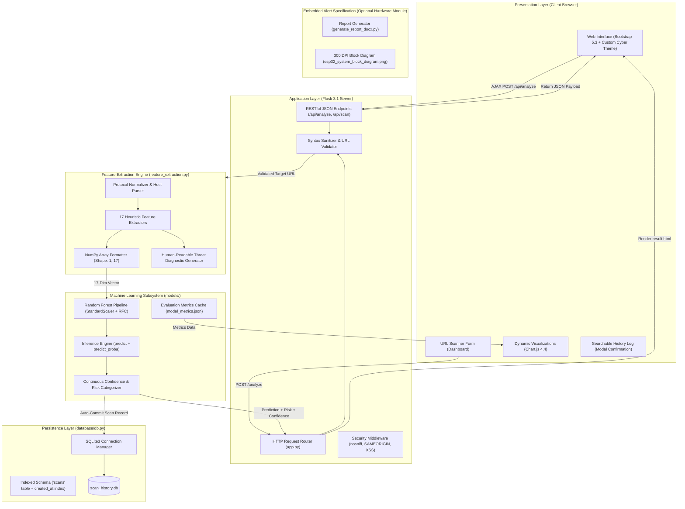
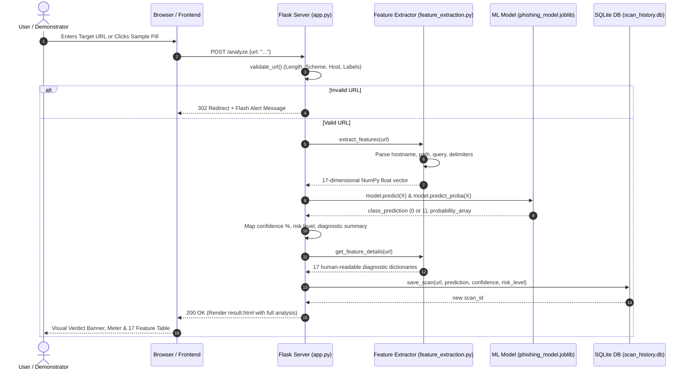

# System Architecture: Machine Learning Based Phishing Website Detection System

**Document Version:** 2.0.0  
**Project Directory:** `E:\PROJECT`  
**Classification:** Academic Demonstration & Production-Grade Reference  
**Last Verified:** November 2026  

---

## 1. Executive Summary & System Intent

The **Machine Learning Based Phishing Website Detection System** is an offline, non-destructive, full-stack cybersecurity application designed to inspect, evaluate, and classify Uniform Resource Locators (URLs). The system determines whether a target web address is **Legitimate (Safe)** or **Phishing (Malicious)** using a standardized **17-dimensional lexical and structural feature extraction engine** paired with an empirically trained Scikit-learn Machine Learning classifier.

A core architectural principle is **Zero-Trust Non-Destructive Inspection**: the application never opens outbound sockets, executes remote JavaScript, downloads payloads, or contacts destination hosts. All inferences are derived purely from URL syntax, host topology, delimiter anomalies, and lexical properties.

---

## 2. High-Level Architectural Flow



---

## 3. Subsystem Breakdown & Responsibilities

### 3.1 Presentation Layer (Frontend)
- **Base Scaffold (`templates/base.html`):** Global SaaS layout with collapsible responsive sidebar (`.cp-sidebar`), top action bar (`.cp-top-bar`), notification drawer, real-time health indicator, theme switcher (Dark, High Contrast, Light), and animated radar scanning overlay.
- **Operations Dashboard (`templates/index.html`):** Security Operations Center overview with 6 live KPI cards, daily scan volume activity chart, classification ratio doughnut, recent audits table, and quick scanner console.
- **URL Scanner Console (`templates/scanner.html`):** Dedicated threat investigation console with input validation, clearing button, sample pills, and offline execution indicators.
- **Scan Diagnostic Report (`templates/result.html`):** Diagnostic report with high-visibility verdict banner (Legitimate vs Phishing), continuous confidence meter, measured latency in milliseconds, target URL display, and full 17-vector breakdown table.
- **Scan Audit Trail (`templates/history.html`):** Paginated SQLite audit trail with keyword search, sorting, classification filters, and CSV export.
- **Threat Analytics Center (`templates/analytics.html`):** Comprehensive telemetry analytics with 4 Chart.js charts: Daily Scan Activity, Classification Ratio, Risk Severity Breakdown, and Confidence Score Distribution.
- **Model Performance & Evaluation (`templates/model_performance.html`):** Empirical benchmarks: Accuracy, Precision, Recall, F1-Score, ROC-AUC, 2x2 confusion matrix (TN, FP, FN, TP), multi-model comparison bar chart, and feature importance bar chart.
- **Security Insights & Tactics (`templates/security_insights.html`):** Knowledge base exploring adversarial attack anatomy, heuristic engineering principles, and mitigations.
- **Platform Settings & Diagnostics (`templates/settings.html`):** Theme controls, display preferences, local SQLite metadata, and offline engine health.
- **Platform Architecture & Docs (`templates/about.html`):** Comprehensive documentation detailing attack anatomy, heuristic engineering rationale, and RESTful API endpoints.
- **Custom Error Handlers (`templates/404.html`, `templates/500.html`):** Branded custom cybersecurity error pages with recovery actions.
- **Styles & Scripts (`static/css/style.css`, `static/js/script.js`):** Responsive dark operations theme with Chart.js bindings, clipboard helpers, loading state managers, and accessible form controls.

### 3.2 Application Layer (Flask Web Backend)
- **Application Core (`app.py`):**
  - Manages application lifecycle, model caching, metrics caching, and SQLite integration.
  - Implements defensive URL syntax validation (`validate_url`) enforcing scheme restriction (HTTP/HTTPS only), length limits (max 2048 chars), control character sanitization, and DNS label syntax.
  - Exposes HTML routes (`/`, `/analyze`, `/result/<id>`, `/history`, `/clear-history`, `/model-performance`, `/about`).
  - Exposes RESTful JSON endpoints (`/api/analyze` and `/api/scan`) for external integration.
  - Enforces HTTP security headers (`X-Content-Type-Options`, `X-Frame-Options`, `X-XSS-Protection`, `Referrer-Policy`) on all responses.

### 3.3 Feature Extraction Engine (`feature_extraction.py`)
Standardizes any arbitrary input URL into a strict 17-dimensional mathematical vector:

| Vector Index | Feature Name | Representation | Adversarial Vector / Threat Signal |
|:---:|:---|:---:|:---|
| 0 | `url_length` | Numeric (float) | Long URLs (>75 chars) conceal redirect payloads or embedded queries. |
| 1 | `domain_length` | Numeric (float) | Deceptive hostnames pad trusted brands with extra characters. |
| 2 | `num_dots` | Numeric (float) | 3+ dots signify nested disguised subdomains. |
| 3 | `num_hyphens` | Numeric (float) | Hyphens in domains mimic official trademarks (e.g., `paypal-security`). |
| 4 | `num_digits` | Numeric (float) | High digit counts represent autogenerated hashes or session IDs. |
| 5 | `has_ip_address` | Binary (0.0/1.0) | Direct IPv4/IPv6 host access evades WHOIS registration tracking. |
| 6 | `is_https` | Binary (0.0/1.0) | Protocol encryption status. |
| 7 | `has_at_symbol` | Binary (0.0/1.0) | `@` credentials symbol causes browsers to ignore preceding text. |
| 8 | `num_suspicious_symbols` | Numeric (float) | Count of query delimiters (`?`, `=`, `&`, `%`, `~`, `+`, `$`, `#`, `!`). |
| 9 | `num_subdomains` | Numeric (float) | Subdomain depth beyond standard domain hierarchy. |
| 10 | `is_shortened` | Binary (0.0/1.0) | Match against 50+ known URL shortening services (`bit.ly`, `tinyurl`, etc.). |
| 11 | `path_length` | Numeric (float) | Deep directory paths indicate embedded credential landing pages. |
| 12 | `num_query_params` | Numeric (float) | Count of query parameters carrying stolen tokens. |
| 13 | `has_sensitive_keywords` | Numeric (float) | Frequency of keywords (`login`, `verify`, `banking`, `secure`, `account`). |
| 14 | `has_double_slash_redirect` | Binary (0.0/1.0) | Presence of `//` inside the path component indicating open redirection. |
| 15 | `prefix_suffix_hyphen` | Binary (0.0/1.0) | Hostnames with hyphens separating brand prefixes/suffixes. |
| 16 | `has_tld_in_subdomain` | Binary (0.0/1.0) | TLD spoofing (e.g., `.com.` embedded inside subdomain). |

### 3.4 Machine Learning Subsystem (`models/`, `train_model.py`)
- **Dataset (`data/phishing_dataset.csv`):** Exactly 7,000 balanced real-world URLs (3,500 legitimate from Cisco OpenDNS and UNB CIC; 3,500 phishing from PhishTank and OpenPhish).
- **Training Pipeline (`train_model.py`):**
  - Executes 80/20 stratified split (5,600 train / 1,400 held-out test).
  - Evaluates 4 candidate algorithms under identical preprocessing: Random Forest, Gradient Boosting, Decision Trees, and Logistic Regression.
  - Selects the champion model based on test F1-score: **Random Forest Pipeline** (`StandardScaler` + `RandomForestClassifier(n_estimators=100, max_depth=16)`).
  - Performs an academic generalization check using **GroupShuffleSplit by domain** (zero domain overlap between train and test).
  - Serializes pipeline to `models/phishing_model.joblib` and metrics to `models/model_metrics.json`.

### 3.5 Persistence Layer (`database/db.py`)
- **SQLite Engine:** Manages `database/scan_history.db`.
- **Schema:**
  ```sql
  CREATE TABLE IF NOT EXISTS scans (
      id INTEGER PRIMARY KEY AUTOINCREMENT,
      url TEXT NOT NULL,
      prediction TEXT NOT NULL,
      confidence REAL NOT NULL,
      risk_level TEXT NOT NULL,
      created_at TIMESTAMP DEFAULT CURRENT_TIMESTAMP
  );
  CREATE INDEX IF NOT EXISTS idx_scans_created ON scans(created_at DESC);
  ```
- **Security:** 100% parameterized SQL queries (`?` placeholders) protecting against SQL injection attacks.

### 3.6 Auxiliary Hardware Alert Module (`generate_diagram_and_doc.py`)
- Includes an academic hardware interface specification for an **ESP32 IoT Edge Alert Subsystem**.
- Provides a 300 DPI high-resolution block diagram (`esp32_system_block_diagram.png`) illustrating an ESP32 microcontroller with RFID authentication, camera capture, LCD display, buzzer, UART communication, and power supply unit for physical security station integration.

---

## 4. End-to-End Data Flow Sequence



---

## 5. Directory Structure & Key Files

```
E:\PROJECT\
│
├── app.py                              # Flask Web application backend & API endpoints
├── feature_extraction.py               # 17-feature lexical & structural extraction module
├── train_model.py                      # Multi-algorithm ML training & evaluation pipeline
├── test_system.py                      # Automated test suite (47 unit & integration tests)
├── run_comprehensive_e2e_tests.py      # Live end-to-end HTTP test runner (49 tests)
├── requirements.txt                    # Project dependency specification
├── README.md                           # Documentation & quick start guide
│
├── data/
│   ├── download_dataset.py             # Dataset fetcher & synthesizer (OpenDNS, PhishTank, UNB)
│   └── phishing_dataset.csv            # Balanced dataset (7,000 URLs: 3,500 benign / 3,500 phish)
│
├── database/
│   ├── db.py                           # Parameterized SQLite persistence helper
│   └── scan_history.db                 # SQLite database storing historical scan records
│
├── models/
│   ├── phishing_model.joblib           # Serialized champion Random Forest pipeline
│   ├── model_metrics.json              # Empirical evaluation metrics & feature importances
│   └── backup/                         # Baseline model and metrics backups
│
├── templates/
│   ├── base.html                       # Base Jinja2 layout, navbar, loader & footer
│   ├── index.html                      # Dashboard, scanner form, sample pills & KPI cards
│   ├── result.html                     # Full diagnostic report & 17-vector feature table
│   ├── history.html                    # Searchable historical scan log with modal wipe
│   ├── model_performance.html          # ML metrics, confusion matrix & Chart.js charts
│   └── about.html                      # Educational threat anatomy & feature guide
│
├── static/
│   ├── css/style.css                   # Cyber defense dark operations stylesheet
│   ├── js/script.js                    # UI interactions, loading radar, Chart.js logic
│   └── images/logo.svg                 # Custom SVG vector brand shield logo
│
├── generate_diagram_and_doc.py         # Matplotlib ESP32 diagram & Docx report builder
├── generate_report_docx.py             # Comprehensive academic Word report generator
├── esp32_system_block_diagram.png      # 300 DPI high-resolution hardware block diagram
└── Phishing_Website_Detection_System_Report.docx # Formatted Word documentation report
```

